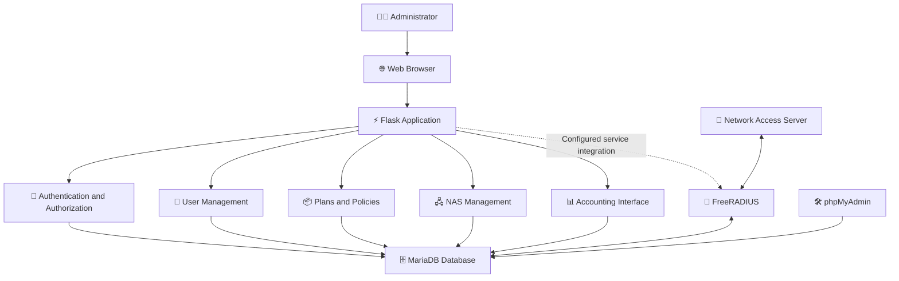

# 🌐 SafeNet RADIUS Manager

<div align="center">

<!-- 🌊 ANIMATED HERO HEADER -->


<!-- ⌨️ TYPING ANIMATION -->
<a href="https://github.com/">

</a>

<br/>

<!-- 🏷️ PROJECT BADGES -->


<br/>


<br/><br/>

**🚀 One Dashboard. Multiple Vendors. Centralized RADIUS Management.**

*An administration platform designed to simplify network authentication, authorization, accounting, device configuration, and user management through a centralized web interface.*

</div>

---

## 🌌 Table of Contents

- [✨ Overview](#-overview)
- [🎯 Project Vision](#-project-vision)
- [⚡ Core Features](#-core-features)
- [🌍 Multi-Vendor Ecosystem](#-multi-vendor-ecosystem)
- [🧠 System Architecture](#-system-architecture)
- [🛠️ Technology Stack](#️-technology-stack)
- [🚀 Installation Guide](#-installation-guide)
- [🔐 Environment Configuration](#-environment-configuration)
- [👨‍💻 User Management](#-user-management)
- [📦 Plans and Policies](#-plans-and-policies)
- [🖧 Network Device Management](#-network-device-management)
- [📊 Accounting and Monitoring](#-accounting-and-monitoring)
- [🌐 Vendor Configuration Examples](#-vendor-configuration-examples)
- [🧪 Testing and Troubleshooting](#-testing-and-troubleshooting)
- [🛡️ Security Best Practices](#️-security-best-practices)
- [💾 Backup and Recovery](#-backup-and-recovery)
- [⚙️ Performance and Maintenance](#️-performance-and-maintenance)
- [📂 Project Structure](#-project-structure)
- [🗺️ Roadmap](#️-roadmap)
- [🤝 Contributing](#-contributing)
- [📜 License](#-license)
- [🙏 Acknowledgments](#-acknowledgments)

---

## ✨ Overview

<div align="center">


</div>

**SafeNet RADIUS Manager** is a Flask-based, Dockerized web application for managing FreeRADIUS authentication infrastructure across multiple network equipment vendors.

The platform provides a centralized administrative interface for managing network users, service plans, RADIUS attributes, Network Access Server (NAS) devices, and accounting records.

Instead of managing every component independently, administrators can use SafeNet to organize their RADIUS infrastructure from one web application.

### 💡 The Core Idea

> **Make network access management easier to configure, monitor, and maintain.**

SafeNet is designed for network administrators, internet service providers, campus networks, enterprise IT teams, laboratories, and organizations that need centralized RADIUS administration.

### 🔑 AAA: The Foundation

| Component | Purpose |
|---|---|
| 🔑 Authentication | Verify a user's identity and credentials. |
| 🛡️ Authorization | Apply network access policies and service attributes. |
| 📊 Accounting | Record sessions and track network usage information. |

<div align="center">


</div>

---

## 🎯 Project Vision

SafeNet aims to make RADIUS infrastructure management more accessible through a modern administrative experience.

- 🌐 **Centralization:** Manage supported RADIUS resources through one interface.
- 🔌 **Multi-vendor compatibility:** Configure standard and vendor-specific attributes.
- ⚡ **Operational efficiency:** Reduce repetitive administrative configuration.
- 🔐 **Security awareness:** Use protected administrative access and secure deployment practices.
- 📊 **Visibility:** Review accounting records and session information.
- 🐳 **Portable deployment:** Run application services using Docker Compose.
- 🧩 **Extensibility:** Maintain a foundation for additional vendors and capabilities.

---

## ⚡ Core Features

<div align="center">


</div>

### 👤 1. User Management

Manage RADIUS user accounts through the administrative interface.

- ➕ Create user accounts.
- ✏️ Edit account details.
- 🗑️ Delete users when appropriate.
- 🔑 Configure authentication credentials.
- 📦 Assign users to service plans.
- 📅 Configure optional expiration dates.
- 🟢 Enable or disable accounts.
- 🔍 Review user records.

### 📦 2. Plans and Policies

Define reusable access policies with RADIUS attributes.

- Create and edit service plans.
- Organize plan descriptions.
- Associate plans with vendor configurations.
- Configure standard RADIUS attributes.
- Configure supported vendor-specific attributes.
- Define attribute operators and values.

Example attributes include:

- `Session-Timeout`
- `Idle-Timeout`
- `Mikrotik-Rate-Limit`
- `Cisco-AVPair`

*Actual enforcement depends on the RADIUS configuration, NAS vendor, and supported attributes.*

### 🖧 3. NAS Device Management

Organize the network devices that communicate with FreeRADIUS.

- Register NAS devices.
- Record device IP addresses.
- Configure short names and vendor information.
- Associate RADIUS shared secrets.
- Maintain device configuration records.

### 📊 4. Accounting and Monitoring

Inspect available RADIUS accounting information.

- Review active sessions.
- Inspect historical sessions.
- Filter records by username.
- Filter records by NAS IP address.
- Review session status.
- Inspect detailed session records when available.

### 🔐 5. Administrative Security

The supplied application design includes security-related capabilities such as:

- Password-protected administration.
- Bcrypt password hashing.
- CSRF protection.
- Environment-based configuration.
- Containerized service deployment.

**Production note:** These features do not automatically guarantee that an installation is secure. Review authentication flows, authorization checks, session settings, network exposure, secrets, dependencies, and deployment configuration before production use.

### 🎨 6. Responsive Administrative Interface

A Bootstrap 5 interface provides a structured way to navigate:

- Dashboard
- Users
- Plans
- NAS devices
- Accounting
- Authentication pages
- Error pages

---

## 🌍 Multi-Vendor Ecosystem

<div align="center">


</div>

| Vendor | Example use cases |
|---|---|
| Cisco | Cisco-specific attributes, network access policies, and supported AAA integrations |
| MikroTik | Rate-limit attributes and RouterOS-compatible access policies |
| TP-Link | Standard RADIUS attributes supported by the device |
| D-Link | Standard RADIUS authentication attributes |
| UniFi / Ubiquiti | Supported RADIUS policies and VLAN-related attributes |
| Aruba | Supported access attributes and role-related configurations |
| Other compatible devices | Standard RADIUS attributes where supported |

SafeNet is intended to work with standard RADIUS attributes and supported vendor-specific attributes.

**Important:** Listing a vendor does not mean every device model or feature has been independently tested. Vendor-specific functionality depends on the installed dictionaries, FreeRADIUS configuration, device firmware, and the policies supported by the equipment.

---

## 🧠 System Architecture

<div align="center">


</div>



### 🧩 Architectural Components

| Component | Responsibility |
|---|---|
| 🌐 Flask | Web application and administrative interface |
| 🐍 Gunicorn | Production-oriented WSGI application server |
| 🔑 FreeRADIUS | RADIUS authentication, authorization, and accounting services |
| 🗄️ MariaDB | Persistent relational storage |
| 🛠️ phpMyAdmin | Optional database administration interface |
| 🐳 Docker Compose | Container orchestration and service configuration |
| 🎨 Bootstrap 5 | Responsive user interface styling |

The exact integration paths depend on the repository configuration. The web application, database, and FreeRADIUS services must be configured to use compatible credentials, schemas, network connections, and RADIUS policies.

---

## 🛠️ Technology Stack

<div align="center">

<a href="https://www.python.org/"></a>
<a href="https://flask.palletsprojects.com/"></a>
<a href="https://www.docker.com/"></a>
<a href="https://www.mysql.com/"></a>
<a href="https://getbootstrap.com/"></a>
<a href="https://git-scm.com/"></a>
<a href="https://github.com/"></a>

</div>

| Technology | Role |
|---|---|
| Python 3.11 | Application programming language |
| Flask | Web framework |
| FreeRADIUS 3.0 | RADIUS services |
| MariaDB | Relational database |
| Docker | Container runtime |
| Docker Compose | Multi-service orchestration |
| Gunicorn | WSGI server |
| Bootstrap 5 | Responsive frontend |
| WTForms | Form handling, where configured |
| Bcrypt | Password hashing |
| CSRF protection | Request-forgery mitigation |

---

## 🚀 Installation Guide

### 📋 System Requirements

| Requirement | Recommended minimum |
|---|---|
| Operating system | Linux, Windows with Docker Desktop, or macOS |
| Docker | Docker Engine 20.10+ |
| Docker Compose | Compose v2 or compatible installation |
| RAM | 2 GB minimum |
| Disk space | 10 GB available |
| Network | Ports available for the required services |

Requirements vary with the number of users, authentication requests, accounting volume, and enabled services.

### 1️⃣ Clone the Repository

```bash
git clone <repository-url>
cd safenet
```

Replace `<repository-url>` with the actual Git repository URL.

### 2️⃣ Create the Environment File

```bash
cp .env.example .env
```

On Windows PowerShell, you can use:

```powershell
Copy-Item .env.example .env
```

### 3️⃣ Configure Your Secrets

Open `.env` and configure strong, unique values for your installation.

```env
SECRET_KEY=replace-with-a-long-random-secret
DB_PASSWORD=replace-with-a-strong-database-password
DB_ROOT_PASSWORD=replace-with-a-strong-root-password

RADIUS_SECRET=replace-with-a-long-random-radius-secret

ADMIN_USERNAME=admin
ADMIN_PASSWORD=replace-with-a-strong-unique-password
ADMIN_EMAIL=admin@example.com
```

Use the actual variable names required by your `.env.example`, application configuration, and Docker Compose file. These are illustrative configuration entries, not a substitute for checking the repository's exact settings.

**Never commit real passwords, RADIUS secrets, or production environment files to GitHub.**

### 4️⃣ Build the Containers

```bash
docker compose build
```

If your environment uses the older command syntax:

```bash
docker-compose build
```

### 5️⃣ Start the Services

```bash
docker compose up -d
```

### 6️⃣ Verify Service Status

```bash
docker compose ps
```

Inspect application logs:

```bash
docker compose logs -f web
```

### 7️⃣ Open SafeNet

When the default port mapping is configured as described:

🌐 **Web application:** http://localhost:5000

🛠️ **phpMyAdmin:** http://localhost:8081

The URLs above assume the corresponding host-port mappings are present in your Compose configuration.

### 🔑 Initial Login

Use the administrator credentials configured for your installation.

Do not assume that default credentials are identical across repository versions. Verify the actual initialization logic and environment configuration before the first login.

If the application uses a known default password, replace it immediately and ensure that the account cannot be accessed using the old credentials.

---

## 🔐 Environment Configuration

Keep all sensitive configuration outside version control.

| Variable | Purpose |
|---|---|
| `SECRET_KEY` | Flask session and application secret |
| `DB_PASSWORD` | Application database password |
| `DB_ROOT_PASSWORD` | MariaDB root password |
| `RADIUS_SECRET` | Shared secret for the configured RADIUS client |
| `ADMIN_USERNAME` | Initial administrator username, if supported |
| `ADMIN_PASSWORD` | Initial administrator password, if supported |
| `ADMIN_EMAIL` | Administrator email, if supported |

### 🛡️ Environment Checklist

- [ ] Generate a strong Flask secret key.
- [ ] Use unique database passwords.
- [ ] Use a strong RADIUS shared secret.
- [ ] Change any default administrative credentials.
- [ ] Confirm the application actually reads the configured variables.
- [ ] Verify `.env` is excluded from version control.
- [ ] Restrict access to phpMyAdmin.
- [ ] Avoid exposing database ports publicly.
- [ ] Use HTTPS for remote administration.

---

## 👨‍💻 User Management

### ➕ Creating a User

1. Sign in to the SafeNet administrative interface.
2. Open **Users**.
3. Select **Add User**.
4. Enter the username and required authentication details.
5. Assign an optional service plan.
6. Configure an expiration date if supported.
7. Set the account's active status.
8. Save and verify the account.

### ✏️ Maintaining Accounts

Administrators can use the available user-management functions to maintain account records.

Before deleting or disabling an account, consider its effect on active sessions and your organization's retention requirements.

### 🔑 Credential Handling

The existing documentation describes cleartext user-password authentication.

Cleartext RADIUS password storage or transmission must not be confused with secure administrative password hashing. Protect credentials at rest and in transit, use supported secure authentication methods where appropriate, and review the FreeRADIUS and NAS configuration before production deployment.

---

## 📦 Plans and Policies

Plans allow administrators to organize reusable RADIUS attributes.

### Example: Basic Access Plan

| Attribute | Example value | Purpose |
|---|---|---|
| `Session-Timeout` | `3600` | Session timeout in seconds |
| `Idle-Timeout` | `600` | Idle-session timeout in seconds |
| `Mikrotik-Rate-Limit` | `10M/10M` | Example MikroTik rate-limit attribute |

These are illustrative values, not universal settings. Attribute availability and behavior depend on the NAS vendor and configuration.

### Creating a Plan

1. Open **Plans**.
2. Select **Add Plan**.
3. Enter the plan name and description.
4. Choose the applicable vendor setting.
5. Add supported RADIUS attributes.
6. Select the appropriate operator, such as `:=`, where applicable.
7. Save the plan.
8. Assign the plan to the intended user accounts.

**Tip:** Test new attributes against a non-production test account before applying a policy to a live network.

---

## 🖧 Network Device Management

A Network Access Server (NAS) is a network device that communicates with the RADIUS server.

### Registering a NAS

1. Open **NAS Devices**.
2. Click **Add NAS**.
3. Enter the device's IP address.
4. Assign a descriptive short name.
5. Configure the shared secret.
6. Select the vendor and device type.
7. Save the device.
8. Configure the actual router, switch, access point, or controller to use matching server details and credentials.

### 🔐 Shared Secret Rules

The NAS and RADIUS server must use matching shared secrets.

- Use a unique secret for each device where practical.
- Avoid predictable words and short passwords.
- Never share secrets in screenshots, public issues, or repository commits.
- Restrict UDP ports 1812 and 1813 to authorized devices.
- Update both sides when rotating a secret.

---

## 📊 Accounting and Monitoring

Accounting records help administrators inspect network sessions and usage.

### Available workflows

- 🔍 Search records by username.
- 🖧 Filter by NAS IP address.
- 🟢 Inspect active sessions.
- 📚 Review closed sessions.
- 📋 View session details.

### Example SQL Queries

Inspect users in the RADIUS check table:

```sql
SELECT *
FROM radcheck
LIMIT 100;
```

Inspect sessions that have not recorded a stop time:

```sql
SELECT *
FROM radacct
WHERE acctstoptime IS NULL;
```

Inspect recent accounting records:

```sql
SELECT *
FROM radacct
ORDER BY acctstarttime DESC
LIMIT 50;
```

These queries assume that the relevant tables and columns exist in your configured database schema.

---

## 🌐 Vendor Configuration Examples

> Replace placeholder IP addresses and secrets with the actual values from your network. The examples must be adapted to the vendor, firmware, authentication service, and installed RADIUS configuration.

### 🔵 Cisco Router

An illustrative IOS-style configuration:

```text
aaa new-model

aaa authentication login default group radius local
aaa authorization network default group radius
aaa accounting network default start-stop group radius

radius server SAFENET
 address ipv4 <your-server-ip> auth-port 1812 acct-port 1813
 key <your-radius-secret>
```

The exact AAA syntax and authorization behavior vary by Cisco platform and software version.

In SafeNet:

1. Register the Cisco NAS.
2. Configure its matching shared secret.
3. Create a plan.
4. Add supported Cisco-specific or standard attributes.
5. Test with a dedicated account.

### 🔴 MikroTik RouterOS

Illustrative RADIUS client configuration:

```text
/radius
add address=<your-server-ip> secret=<your-radius-secret> service=login
```

For PPP, wireless, hotspot, or other services, configure the appropriate service type and RouterOS authentication settings.

In SafeNet:

1. Register the MikroTik device.
2. Create a plan with supported attributes.
3. Test the intended service.
4. Verify authentication and accounting logs.

### 🔷 UniFi / Ubiquiti

A typical setup involves:

1. Open the appropriate UniFi settings.
2. Locate the RADIUS profile or authentication configuration.
3. Enter the RADIUS server address.
4. Set authentication port `1812`.
5. Configure the shared secret.
6. Configure accounting on port `1813` where required.
7. Apply the profile to the intended network or access policy.
8. Test connectivity and authentication.

Interface names vary across UniFi versions and product families.

### 🟢 Other RADIUS-Compatible Devices

For other devices, verify:

- Supported RADIUS authentication methods.
- Authentication and accounting ports.
- Shared-secret configuration.
- Standard attribute support.
- Vendor-specific dictionary requirements.
- Network reachability and firewall rules.

---

## 🧪 Testing and Troubleshooting

### 🔑 Test RADIUS Authentication

If the container is named `safenet-radius`, open a shell:

```bash
docker exec -it safenet-radius bash
```

Run an authentication test using a test account:

```bash
radtest <username> <password> localhost 0 <radius-secret>
```

Use the appropriate test secret and client configuration for your environment. A local test will fail if the relevant client is not configured to accept the request.

### 🐛 Run FreeRADIUS in Debug Mode

Stop or isolate the existing service if necessary, then run the appropriate debug command according to your container configuration.

For example:

```bash
docker compose exec freeradius freeradius -X
```

Some images use a different executable path or container name. Debug mode may require stopping the normal daemon first.

### 📜 View Service Logs

```bash
docker compose logs -f web
```

```bash
docker compose logs -f freeradius
```

```bash
docker compose logs -f db
```

### 🗄️ Inspect the Database

```bash
docker compose exec db mysql -u radius -p radius
```

Then execute a query such as:

```sql
SHOW TABLES;
```

Enter the configured database password when prompted.

### 🚨 Common Problems

| Problem | Possible checks |
|---|---|
| Web application unavailable | Container status, port mapping, application logs |
| Database connection failure | Credentials, service health, network and startup dependencies |
| Authentication rejected | User record, password format, RADIUS policies, debug logs |
| NAS cannot connect | Firewall, routing, server address, UDP ports |
| Shared-secret mismatch | Confirm the NAS and server use the same secret |
| Missing accounting records | Accounting configuration, NAS settings, SQL module |
| Vendor attribute ignored | Dictionary, attribute name, device support, policy configuration |
| phpMyAdmin unavailable | Container status and host-port mapping |

---

## 🛡️ Security Best Practices

<div align="center">


</div>

### Essential Controls

- 🔑 Change default credentials immediately.
- 🔐 Use strong, unique secrets.
- 🧂 Verify password hashing and authentication behavior.
- 🛡️ Keep CSRF protection enabled for applicable web forms.
- 🔒 Deploy HTTPS through a properly configured reverse proxy.
- 🧱 Restrict administrative access using firewall rules or a private network.
- 🌐 Allow RADIUS traffic only from authorized NAS devices.
- 🗄️ Keep MariaDB private and avoid unnecessary exposed ports.
- 🧰 Restrict or remove phpMyAdmin in production.
- 📦 Regularly update dependencies and container images.
- 💾 Encrypt and test backups.
- 🧾 Keep useful audit records while protecting sensitive information.
- 🚫 Never commit `.env` files or real credentials.
- 🔍 Test access-control rules before deploying publicly.

### Suggested Network Boundaries

| Port | Service | Recommended exposure |
|---|---|---|
| `5000/tcp` | Flask application | Local development or restricted administration |
| `8081/tcp` | phpMyAdmin | Private administration only; disable or remove if unnecessary |
| `1812/udp` | RADIUS authentication | Authorized NAS devices |
| `1813/udp` | RADIUS accounting | Authorized NAS devices |
| `3306/tcp` | MariaDB, if exposed | Private network only |

Actual exposure depends on Docker port mappings, host firewall rules, and deployment topology.

**Production warning:** Do not expose administrative interfaces, database services, or RADIUS ports indiscriminately to the public internet.

---

## 💾 Backup and Recovery

### Create a Database Backup

For a MariaDB container named `safenet-db`:

```bash
docker exec safenet-db sh -c \
  'exec mariadb-dump -u radius -p"$DB_PASSWORD" radius' \
  > backup.sql
```

This example assumes the container has the required client utility and `DB_PASSWORD` environment variable. Verify that assumption before relying on the command.

Alternatively, use the database's supported backup command with credentials supplied through a secure mechanism.

### Restore a Backup

For a compatible SQL dump:

```bash
docker exec -i safenet-db mariadb \
  -u radius -p radius < backup.sql
```

Enter the password if prompted. Confirm the correct target database before restoring because existing records may be affected.

### Backup Checklist

- [ ] Schedule regular database backups.
- [ ] Store backups outside the application container.
- [ ] Restrict access to backup files.
- [ ] Encrypt sensitive backup archives.
- [ ] Keep a separate recovery copy.
- [ ] Test restoration periodically.
- [ ] Document database and application recovery procedures.

---

## ⚙️ Performance and Maintenance

### Monitor the Containers

```bash
docker compose ps
docker stats
```

### Restart Services

```bash
docker compose restart
```

### Rebuild After Code Changes

```bash
docker compose down
docker compose build --no-cache
docker compose up -d
```

Review persistent volumes and environment configuration before making destructive changes.

### Gunicorn Tuning Example

The following is an example, not a universal production setting:

```yaml
command: gunicorn --bind 0.0.0.0:5000 --workers 4 --timeout 120 app:app
```

Worker count should be selected based on available CPU, memory, application behavior, database connection limits, and workload.

### FreeRADIUS Thread Pool

FreeRADIUS thread pool configuration depends on the installed version and the syntax of its configuration files. Review the existing `radiusd.conf` before changing thread counts.

Benchmark representative authentication and accounting workloads before increasing concurrency.

### ⚠️ Avoid Destructive Cleanup

Commands that remove Docker volumes can permanently delete database data.

Before using cleanup commands, identify which volumes contain persistent application or database records and make a verified backup.

---

## 📂 Project Structure

```text
safenet/
├── app.py
├── config.py
├── models.py
├── forms.py
├── requirements.txt
├── Dockerfile
├── docker-compose.yml
├── .env.example
│
├── database/
│   └── schema.sql
│
├── freeradius/
│   ├── Dockerfile
│   ├── radiusd.conf
│   ├── clients.conf
│   └── mods-available/
│       └── sql
│
├── templates/
│   ├── base.html
│   ├── dashboard.html
│   ├── auth/
│   ├── users/
│   ├── plans/
│   ├── nas/
│   ├── accounting/
│   └── errors/
│
└── static/
    ├── css/
    ├── js/
    └── img/
```

This is the documented reference structure. Actual files and directories may vary by repository version.

---

## 🗺️ Roadmap

<div align="center">


</div>

Potential future improvements include:

- [ ] 📈 Enhanced dashboard metrics and charts.
- [ ] 🔔 Configurable alerts for important operational events.
- [ ] 🧾 Improved administrative audit logs.
- [ ] 🔍 Advanced filtering and search.
- [ ] 👥 Role-based administrative permissions.
- [ ] 📊 Exportable accounting reports.
- [ ] 🔐 Improved authentication and account-recovery workflows.
- [ ] 🧪 Automated application and RADIUS integration tests.
- [ ] 🐳 Improved health checks and service observability.
- [ ] 🌐 Additional vendor-specific integration tests.
- [ ] 💾 Documented and tested backup automation.
- [ ] 📱 Further improvements to mobile administration.

*These are roadmap ideas, not claims that the features have already been implemented.*

---

## 🤝 Contributing

Contributions, bug reports, documentation improvements, and security-conscious suggestions are welcome.

### Contribution Workflow

1. Fork the repository.
2. Create a feature branch.
3. Implement and test your changes.
4. Document configuration changes.
5. Open a pull request describing the improvement.

Example:

```bash
git checkout -b feature/your-improvement
git add .
git commit -m "Improve SafeNet functionality"
git push origin feature/your-improvement
```

### Contribution Guidelines

- Keep changes focused and reviewable.
- Never include real credentials or private infrastructure details.
- Test changes against the supported environment.
- Document new configuration variables.
- Avoid claiming vendor compatibility without testing.
- Report security vulnerabilities privately rather than publishing exploitable details.

---

## 📜 License

This project is distributed under the MIT License, as specified by the project documentation.

If a `LICENSE` file is present in the repository, consult that file for the authoritative license terms.

---

## 🙏 Acknowledgments

Special thanks to the open-source communities behind:

- 🐍 Python
- ⚡ Flask
- 🔑 FreeRADIUS
- 🐳 Docker
- 🗄️ MariaDB
- 🎨 Bootstrap
- 🌍 GitHub and its open-source contributors

Their tools and documentation make projects like SafeNet possible.

---

## 🌟 Final Words

<div align="center">


<br/>


**🔐 SafeNet RADIUS Manager — Built for centralized network access management.**

*Designed to help network administrators manage authentication, authorization, and accounting with greater clarity and control.*

<br/>

⭐ **If you find this project useful, consider giving the repository a star!** ⭐

</div>

---

<div align="center">

<sub>Made with ❤️, ☕, 🐍 and 🐳 by the open-source community.</sub>

<sub>Documentation should always reflect the actual implementation and configuration of the deployed version.</sub>

</div>
